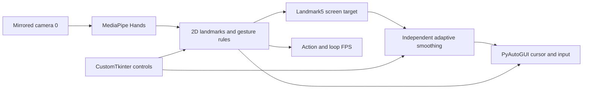
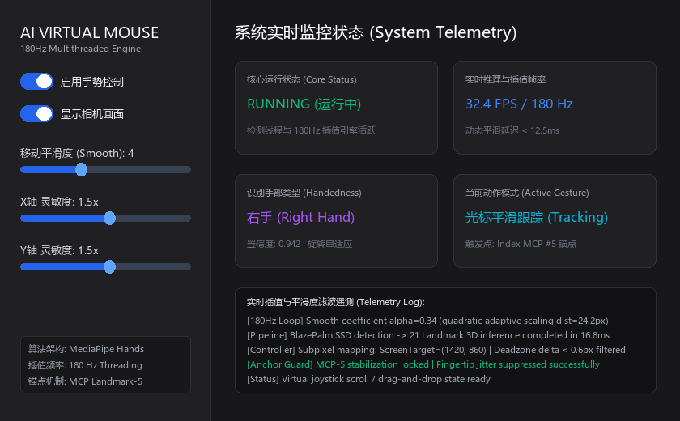

# Virtual Mouse and Gesture Control

A camera-driven gesture mouse using MediaPipe Hands, OpenCV, PyAutoGUI, and CustomTkinter.

[简体中文](README.md) · **English** · [日本語](README_JA.md)

**Explore:** [Technical notes](docs/technical-notes.en.md) · [Setup and operation](docs/setup.en.md)

Existing hand-landmark inference is connected to desktop input through joint tracking, palm-scale ratios, smoothing, and gesture states. Vision, cursor convergence, and GUI updates run separately. No project-trained hand model or reproducible industrial/fixed-latency performance is claimed.

## Architecture



The detection worker requests 640×480. Another daemon sleeps `1/180 s` between smoothing iterations; GUI telemetry updates every 100 ms. These are scheduling settings, not measured 180 Hz input or camera performance.

## Controls and implementation

| Action | Actual condition |
| :--- | :--- |
| Move | Outside scroll mode, index extended or left button held; always track index-base Landmark 5. |
| Left/drag | In the movement branch, thumb/index-tip distance divided by palm scale below 0.35 triggers mouseDown; release triggers mouseUp. |
| Right click | Only outside movement/scroll branches, thumb/middle ratio below 0.35, with a 0.5 s interval. |
| Scroll | Index/middle/ring extended, little finger folded; middle-base vertical offset from entry acts as a joystick. |
| GUI | Control/preview toggles, smoothing 1–15, X/Y sensitivity 1–3, handedness/action/loop FPS. |

Palm scale is the 2D wrist-to-Landmark 9 distance. Camera deadzone 0.6 pixels and target deadzone 1.5 pixels accompany distance-dependent smoothing. [Equations and branch priority](docs/technical-notes.en.md).

## Demonstration and evidence



Historical tracking/pinch views are in the [notes](docs/technical-notes.en.md#evidence). The 180 Hz card is fixed text, not telemetry. Reproducible CPU/memory/latency/multi-resolution benchmark records are absent.

All four Python files parsed in this audit. Camera, GUI, and actual mouse events were not exercised.

## Quick start

```powershell
python -m pip install -r requirements.txt
python main.py
```

Use a desktop Python environment with camera/system-input permissions and MediaPipe providing `mp.solutions.hands`. Control is enabled at startup and camera 0 is opened. Read [operation and exit limitations](docs/setup.en.md) before use. There is no network controller or project-checkpoint preparation step.

## Limits and next steps

Only x/y are used; full 3D pose, arbitrary-view, or depth invariance is not established. Ratios reduce scale sensitivity only. A held right pinch can repeat clicks; an open palm can still move. Disable/close paths can leave the left button held.

Fix input release on disable/errors, right-click edges, zero palm scale, and thread coordination before collecting input/output timing and task-success results. Source remains unchanged; this pass corrects documentation.

## Attribution and license

Maintained by **Chaoran Liu / 刘超然**. MediaPipe supplies detection/landmark models; project code integrates rules, input, smoothing, and GUI. MCP here means the metacarpophalangeal joint, not Model Context Protocol.

Code: [MIT](LICENSE); dependencies retain their licenses. [Technical notes](docs/technical-notes.en.md) · [Setup](docs/setup.en.md)
