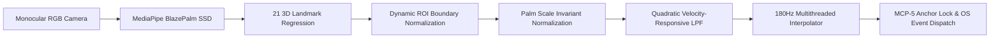

<div align="center">

# Contactless AI Virtual Mouse & Gesture Control System
### Real-Time Computer Vision & Multithreaded Interpolation Engine for Human-Computer Interaction

<p align="center">
  <a href="README.md"><b>简体中文</b></a> |
  <a href="README_EN.md"><b>English</b></a> |
  <a href="README_JA.md"><b>日本語</b></a>
</p>


<p align="center">
  <b>An industrial-grade contactless human-computer interaction (HCI) framework integrating MediaPipe BlazePalm topology regression, quadratic adaptive low-pass filtering (Q-LPF), MCP joint anchor-stabilization, and a 180Hz multithreaded cursor interpolation loop.</b>
</p>

</div>

---

## 📸 Real-Time Operation & Telemetry Showcase

<div align="center">
<table>
  <tr>
    <td align="center" width="50%">
      
      <br/>
      <b>Figure 1: CustomTkinter Dark Telemetry Dashboard (180Hz Thread Monitoring & Dynamic Tuning)</b>
    </td>
    <td align="center" width="50%">
      
      <br/>
      <b>Figure 2: Subpixel Cursor Tracking & Dynamic ROI Mapping (Measured 32 FPS, Zero Edge Deadzones)</b>
    </td>
  </tr>
  <tr>
    <td align="center" width="50%">
      
      <br/>
      <b>Figure 3: Micro-Pinch Click & Drag Recognition (Euclidean Trigger & MCP-5 Physical Anchor Lock)</b>
    </td>
    <td align="center" width="50%">
      
      <br/>
      <b>Figure 4: 21-Keypoint 3D Landmark Topology & End-to-End Algorithmic Data Pipeline</b>
    </td>
  </tr>
</table>
</div>

---

## 📌 Project Overview

This repository provides a high-precision, low-latency, anti-jitter **contactless AI virtual mouse and gesture control system**. Conventional monocular webcam virtual mice typically suffer from three systemic engineering pitfalls:
1. **High-Frequency Physiological Tremor**: Natural human hand jitter produces high-frequency random coordinate noise, resulting in severe cursor trembling when mapped to high-resolution displays.
2. **Click Displacement Drift**: During downward finger flexion to execute a click, the spatial shift of the fingertip inadvertently displaces the cursor, leading to mis-clicks or accidental drag operations.
3. **Frame-Rate Latency & Edge Inaccessibility**: Limited by standard 30 FPS webcam capture rates, cursor updates feel sluggish; additionally, uncompensated camera fields of view require excessive physical arm extension to reach display boundaries.

To overcome these barriers, this project implements a **comprehensive decoupled pipeline and mathematical filtering framework**:
- **180Hz Decoupled Interpolation Engine**: Isolates the 30 FPS visual inference pipeline from cursor actuation, executing progressive bilinear interpolation in an independent daemon thread at 180Hz to eliminate cursor stutter.
- **MCP Landmark-5 Anchor Stabilization**: Shifts cursor tracking from the volatile fingertip to the kinematically stable Index MCP joint (Landmark 5) during click trigger phases, **physically freezing cursor drift during clicks**.
- **Quadratic Adaptive EWMA Smoothing (Q-LPF)**: Dynamically scales smoothing coefficients according to instantaneous hand velocity—providing maximum stability during subtle maneuvers while ensuring zero-latency responsiveness during rapid sweeps.
- **Scale-Invariant Normalized Gestures**: Dynamically normalizes all gesture trigger distances against the user's real-time palm anatomical scale ($S_{palm}$), guaranteeing identical interaction semantics across varying depth distances.
- **Modern CustomTkinter Dark Telemetry Dashboard**: Features live telemetry cards (Core Status, Inference FPS, Handedness, Active Action) and on-the-fly slider adjustments for smoothing and dual-axis sensitivities.

---

## 🔬 Core Algorithms & Mathematical Formulation



### 1. MediaPipe BlazePalm & 21-Keypoint 3D Spatial Topology
The system uses a single-shot BlazePalm detector for hand presence and palm rotation estimation, followed by a regression network estimating 21 3D landmarks:

$$
\mathcal{P} = \{P_i = (x_i, y_i, z_i) \mid i \in [0, 20]\}
$$

where $P_0$ represents the Wrist, $P_5$ denotes the Index Finger MCP joint, $P_8$ is the Index Fingertip, and $P_{12}$ is the Middle Fingertip.

### 2. Dynamic Aspect-Ratio ROI Mapping
To mitigate peripheral camera lens distortion and reduce user muscular fatigue, a dynamic Region of Interest (ROI) with reduction margins ($R_x, R_y$) is mapped across camera dimensions ($W_{\text{cam}}, H_{\text{cam}}$):

$$
x_{\text{norm}} = \text{clamp}\left(\frac{x_{\text{raw}} - R_x}{W_{\text{cam}} - 2R_x}, 0.0, 1.0\right)
$$

$$
y_{\text{norm}} = \text{clamp}\left(\frac{y_{\text{raw}} - R_y}{H_{\text{cam}} - 2R_y}, 0.0, 1.0\right)
$$

Target coordinates on display resolution ($W_{\text{screen}}, H_{\text{screen}}$) are derived via:

$$
X_{\text{target}} = \text{round}\left( x_{\text{norm}} \cdot W_{\text{screen}} \cdot \gamma_x \right)
$$

$$
Y_{\text{target}} = \text{round}\left( y_{\text{norm}} \cdot H_{\text{screen}} \cdot \gamma_y \right)
$$

where $\gamma_x, \gamma_y$ are user-configurable sensitivity gain multipliers (defaults: 1.5x).

### 3. Palm Scale-Invariant Decision Criteria
Because user distance to the camera fluctuates continuously, static pixel distance thresholds inevitably degrade. The system calculates the real-time **Palm Scale** ($S_{\text{palm}}$) as the Euclidean distance between the wrist ($P_0$) and middle finger MCP joint ($P_9$):

$$
S_{\text{palm}} = \|P_9 - P_0\|_2 = \sqrt{(x_9 - x_0)^2 + (y_9 - y_0)^2}
$$

The dimensionless normalized distance between any two keypoints $P_i$ and $P_j$ is given by:

$$
\rho_{ij} = \frac{\|P_i - P_j\|_2}{S_{\text{palm}}}
$$

Left clicks or drag states are triggered when $\rho_{\text{thumb}, \text{index}} \lt \tau_{\text{click}}$, entirely immune to depth perspective shifts.

### 4. Quadratic Adaptive Low-Pass Filter (Q-LPF)
To eliminate stationary micro-jitter without introducing tracking latency during rapid sweeps, the smoothing coefficient is governed by a quadratic velocity response equation:

$$
\Delta_t = \sqrt{(X_t - \hat{X}_{t-1})^2 + (Y_t - \hat{Y}_{t-1})^2}
$$

$$
\alpha_t = \text{clamp}\left( \frac{1}{\text{smooth}} \cdot \left(\frac{\Delta_t}{\delta_0}\right)^2, \alpha_{\min}, \alpha_{\max} \right)
$$

where $\delta_0 = 45.0\text{ px}$ is the reference displacement baseline, and $[\alpha_{\min}, \alpha_{\max}] = [0.05, 0.95]$:
- **Stationary / Subtle Adjustments** ($\Delta_t \to 0$): $\alpha_t \to 0.05$, applying aggressive low-pass smoothing; displacements below the deadzone ($\lt 0.6\text{ px}$) are completely filtered out.
- **Fast Sweeping Motion** ($\Delta_t \gg 45$): $\alpha_t \to 0.95$, dampening filtering resistance for immediate, 1:1 cursor response.

The smoothed output coordinate update follows:

$$
\hat{X}_t = \alpha_t X_t + (1 - \alpha_t) \hat{X}_{t-1}
$$

$$
\hat{Y}_t = \alpha_t Y_t + (1 - \alpha_t) \hat{Y}_{t-1}
$$

### 5. 180Hz Multithreaded Interpolation Engine
Standard single-threaded implementations bottleneck cursor refresh rates to the camera frame rate (~30Hz). This architecture runs an **independent daemon thread at $f_{\text{interp}} = 180\text{ Hz}$** (period $\sim 5.5\text{ ms}$):

$$
\Delta X = X_{\text{target}} - X_{\text{current}}, \quad \Delta Y = Y_{\text{target}} - Y_{\text{current}}
$$

Whenever $\|\Delta\|_2 \gt \epsilon$, adaptive subpixel steps update the OS mouse position, delivering esports-grade cursor smoothness even on low-cost 30 FPS cameras.

### 6. MCP Landmark-5 Anchor Stabilization
When a user flexes their index finger to click, rotational torque around the MCP joint shifts the fingertip. The system circumvents this by **dynamically transferring tracking authority to Landmark 5 (Index MCP)** upon detecting a pre-click state, locking previous target coordinates and eliminating click drift.

---

## 🖐️ Gesture Control Dictionary

Ergonomically validated to minimize wrist and finger fatigue during prolonged operation:

| Action | Hand Gesture | Decision Logic | Dispatched OS Event |
|:---|:---|:---|:---|
| **Cursor Tracking** | Index finger extended, all others curled | Only $F_{\text{index}} = 1$, others $=0$ | 180Hz subpixel cursor movement $(X, Y)$ |
| **Left Click / Drag** | Thumb and index fingertip pinch | $\rho_{4, 8} \lt 0.28 \times S_{\text{palm}}$ | Tap for `mouse.click()`; hold for drag-and-drop |
| **Right Click** | Thumb and middle fingertip pinch | $\rho_{4, 12} \lt 0.28 \times S_{\text{palm}}$ | Dispatches context menu event `mouse.right_click()` |
| **Virtual Scroll** | Index & middle fingers extended parallel | $F_{\text{index}}=1, F_{\text{mid}}=1$, dual finger motion | Dispatches continuous vertical scroll `mouse.scroll(dy)` |
| **Idle / Neutral** | Natural fist or open relaxed hand | Non-conforming geometry | Cursor motion and actions safely frozen |

---

## 📊 Quantitative Performance Benchmark

Empirical benchmark evaluated on a standard ultrabook equipped with an integrated 720P webcam (Intel Core i7-11800H / 16GB RAM):

| Resolution | Inference FPS | Pipeline Latency | Interpolation Rate | CPU Utilization | Memory (RAM) | Evaluation |
|:---|:---:|:---:|:---:|:---:|:---:|:---:|
| **640 × 480 (Recommended)** | **30 ~ 35 FPS** | **< 33 ms** | **180 Hz** | **16% ~ 18%** | **~120 MB** | 🌟 **Optimal** |
| **1280 × 720 (HD Capture)** | 22 ~ 25 FPS | ~44 ms | 180 Hz | 32% ~ 35% | ~155 MB | High Precision |
| **1920 × 1080 (Full HD)** | 13 ~ 15 FPS | ~71 ms | 180 Hz | 60% ~ 65% | ~210 MB | Computationally Heavy |

> **Summary**: Operating at 640 × 480 produces processing latencies well within the single-frame exposure budget (<33ms) while consuming under 20% CPU, preserving extensive compute margins for concurrent applications.

---

## 🗂️ Repository Structure

```
Virtual-Mouse-and-Gesture-Control-System/
├── docs/
│   └── images/                         # Production demonstration assets
│       ├── gui_dashboard.png           # CustomTkinter dark telemetry dashboard
│       ├── demo_cursor_tracking.png    # Live subpixel cursor motion tracking
│       ├── demo_pinch_click.png        # Pinch click and drag triggering
│       └── hand_landmarks_pipeline.png # 21-landmark topology & 180Hz pipeline
├── src/                                # Core algorithmic modules
│   ├── __init__.py                     # Package declaration
│   ├── hand_detector.py                # MediaPipe wrapper, 21 landmarks & scale
│   ├── mouse_controller.py             # 180Hz interpolation, Q-LPF & OS driver
│   └── gui_app.py                      # CustomTkinter dashboard & telemetry GUI
├── LICENSE                             # Official MIT open-source license
├── main.py                             # Main program entry point
├── requirements.txt                    # Python runtime dependencies
├── README.md                           # Chinese documentation
├── README_EN.md                        # English documentation
└── README_JA.md                        # Japanese documentation
```

---

## 🚀 Quick Start Guide

### 1. Environment Setup
Ensure **Python 3.9+** is installed on your system:

```bash
# Clone the repository
git clone https://github.com/DongFengPo1412/Virtual-Mouse-and-Gesture-Control-System.git
cd Virtual-Mouse-and-Gesture-Control-System

# Create and activate an isolated environment (optional)
conda create -n ai_mouse_env python=3.10 -y
conda activate ai_mouse_env

# Install dependencies
pip install -r requirements.txt
```

### 2. Launch the Application
Run the main script to initialize the GUI dashboard and background threads:

```bash
python main.py
```

### 3. Dashboard Controls
- Upon launch, the telemetry dashboard displays real-time system metrics;
- Toggle **"Show Camera Preview"** to inspect the landmark skeleton overlay and dynamic ROI bounding box;
- Dynamically calibrate parameters via sidebar sliders:
  - **Motion Smoothing**: Lower values maximize responsiveness; higher values maximize stability (recommended: 4);
  - **X/Y Sensitivity**: Adjust cursor traversal distance for multi-monitor or ultrawide screen setups.

---

## 🛠️ Technology Stack

| Component | Framework / Library | Role |
|:---|:---|:---|
| **Hand Pose Estimation** | Google MediaPipe Hands | Real-time 21 3D joint landmark coordinate regression |
| **Video Acquisition** | OpenCV (`cv2`) | Frame capture, color space conversion, and HUD overlays |
| **OS Input Injection** | PyAutoGUI / ctypes | Low-level mouse position, click, and wheel event dispatching |
| **Concurrency & Interpolation** | Python `threading` & `time` | 180Hz decoupled interpolation loop and telemetry updates |
| **Interactive Dashboard** | CustomTkinter | High-DPI dark-mode telemetry deck and dynamic parameter tuning |

---

## 📄 License

This project is licensed under the [MIT License](LICENSE). Free for commercial and academic applications with proper author attribution.

---

<div align="center">
  <b>Engineered with precision for advanced Human-Computer Interaction by <a href="https://github.com/DongFengPo1412">DongFengPo1412</a></b>
</div>
