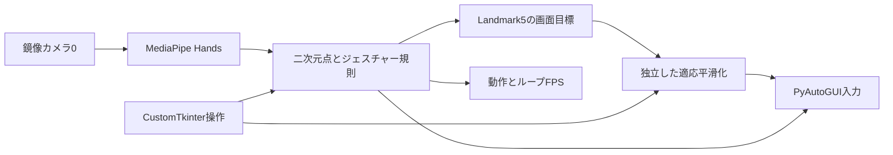

# Virtual Mouse and Gesture Control

MediaPipe Hands、OpenCV、PyAutoGUI、CustomTkinterによるカメラ式ジェスチャーマウスです。

[简体中文](README_ZH.md) · [English](README.md) · **日本語**

**詳細：** [技術ノート](docs/technical-notes.ja.md) · [導入と操作](docs/setup.ja.md)

既存の手ランドマーク推論をOS入力へ接続し、関節位置、掌スケール比、平滑化、操作状態を組み合わせています。視覚処理、カーソル追従、GUI更新は別系統です。独自学習した手モデルや、再現可能な産業品質・固定遅延の成績は主張しません。

## 構成



検出は640×480を要求し、別デーモンは平滑処理間に`1/180 s`待ちます。GUI状態は100 msごとです。スケジュール設定であり、実測180 Hz入力やカメラ性能ではありません。

## 操作と実装

| 操作 | 実条件 |
| :--- | :--- |
| 移動 | スクロール以外で人差し指を伸ばす、または左ボタン保持中。常に付け根Landmark5を追跡。 |
| 左／ドラッグ | 移動分岐内で親指・人差し指先距離／掌スケールが0.35未満でmouseDown、離すとmouseUp。 |
| 右 | 移動・スクロール以外で親指・中指比0.35未満、0.5 s間隔。 |
| スクロール | 人差し指・中指・薬指を伸ばし小指を曲げ、中指付け根の開始位置からのY差で操作。 |
| GUI | 操作／表示切替、平滑度1–15、XY感度1–3、左右手・動作・ループFPS。 |

掌スケールは0–9点の二次元距離です。カメラ0.6画素、画面目標1.5画素のデッドゾーンと残距離による平滑化を使います。[式と優先順位](docs/technical-notes.ja.md)。

## 表示と検証


追従・ピンチの過去画像は[ノート](docs/technical-notes.ja.md#evidence)にあります。180 Hzカードは固定文字で実測ではありません。CPU・メモリ・遅延・複数解像度の再現可能な測定記録はありません。

今回はPython4本の静的解析が通過し、カメラ・GUI・実際のマウスイベントは実行していません。

## クイックスタート

```powershell
python -m pip install -r requirements.txt
python main.py
```

デスクトップGUI・カメラ・OS入力権限と`mp.solutions.hands`対応MediaPipeが必要です。起動時は操作が有効でカメラ0を開きます。[操作・終了の制約](docs/setup.ja.md)を確認してください。ネット操作端末や独自重みの準備はありません。

## 制約と今後

x/y規則は完全な3D不変性を保証せず、開掌でも移動し得ます。今回、停止・手の消失・撮像失敗・終了の入力解放を統一し、右クリックをピンチ開始時のみとしました。退化した掌尺度を拒否し、共有入力状態をロックで保護、平滑化スレッドを停止・joinします。

実OS入力なしの回帰テスト10件が通過しました。カメラ・GUI・実入力の動作、ドライバ終了、遅延は対象環境での検証が必要です。

## 帰属とライセンス

**刘超然 / Chaoran Liu**が管理します。MediaPipeが検出・ランドマークモデルを提供し、規則・入力・平滑化・GUIを統合しています。MCPはここでは中手指節関節で、Model Context Protocolではありません。

コードは[MIT](LICENSE)、依存は各条件に従います。[技術ノート](docs/technical-notes.ja.md) · [導入](docs/setup.ja.md)
