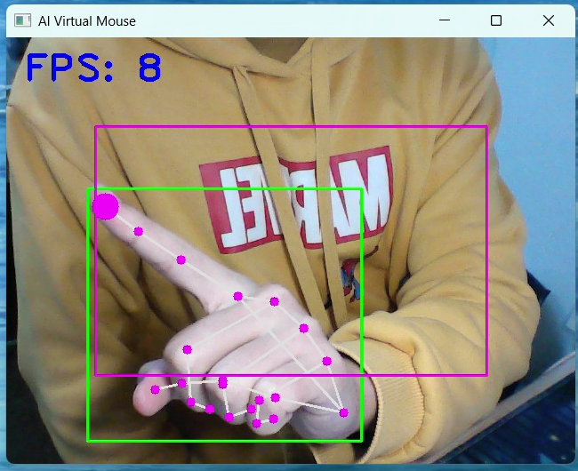
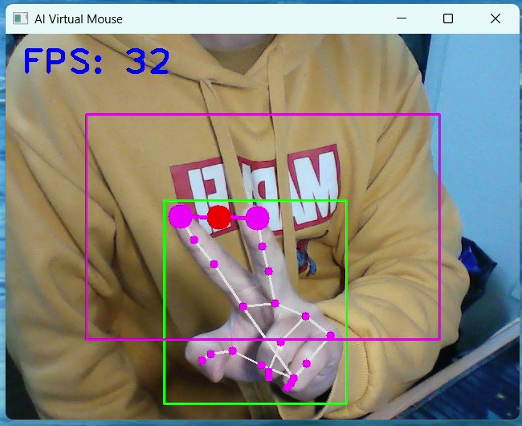
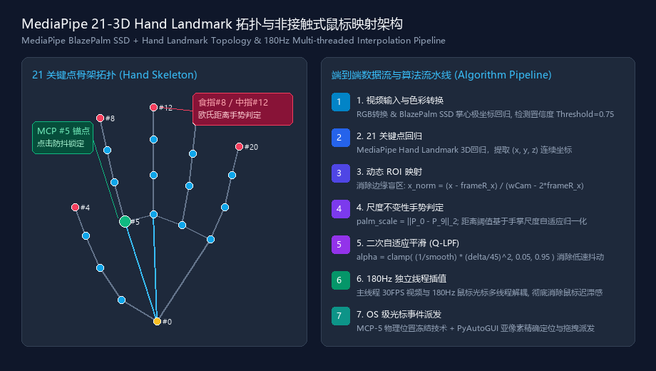
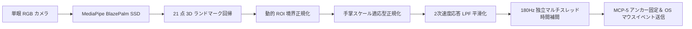

<div align="center">

# コンピュータビジョンと深層学習に基づく非接触型 AI バーチャルマウス＆ジェスチャー制御システム
### Contactless AI Virtual Mouse & Gesture Control System via Real-Time Computer Vision and Multithreaded Interpolation

<p align="center">
  <a href="README.md"><b>简体中文</b></a> |
  <a href="README_EN.md"><b>English</b></a> |
  <a href="README_JA.md"><b>日本語</b></a>
</p>


<p align="center">
  <b>MediaPipe BlazePalm 骨格回帰、2次適応型ローパス平滑化（Q-LPF）、MCP 掌骨アンカー固定、および 180Hz 独立高周波補間エンジンを融合した産業級非接触ヒューマン・コンピュータ・インタラクション（HCI）システム</b>
</p>

</div>

---

## 📸 リアルタイム動作およびシステム遠隔測定デモ (Visual Showcase)

<div align="center">
<table>
  <tr>
    <td align="center" width="50%">
      
      <br/>
      <b>図 1: CustomTkinter モダンダーク遠隔測定ダッシュボード (180Hz スレッド監視＆パラメータ動的調整)</b>
    </td>
    <td align="center" width="50%">
      
      <br/>
      <b>図 2: 人差し指微細トラッキングと動的 ROI マッピング (実測 32 FPS、画面端の不感帯を完全解消)</b>
    </td>
  </tr>
  <tr>
    <td align="center" width="50%">
      
      <br/>
      <b>図 3: ピンチクリックおよびドラッグ認識 (サブピクセル級ユークリッド判定＆ MCP-5 アンカーロック)</b>
    </td>
    <td align="center" width="50%">
      
      <br/>
      <b>図 4: 21 点 3D ハンドランドマークトポロジーおよびエンドツーエンドアルゴリズムパイプライン</b>
    </td>
  </tr>
</table>
</div>

---

## 📌 プロジェクト概要 (Project Overview)

本システムは、高精度・超低遅延・防振性が要求される環境に向けて開発された**非接触型 AI バーチャルマウス＆ジェスチャー制御システム（Human-Computer Interaction, HCI）**です。従来の単眼カメラを用いたバーチャルマウスには、主に以下の 3 つの課題が存在していました：
1. **高周波生理的微収縮（手振れノイズ）**：指先のトラッキング座標に微小なジッターが混入し、高解像度ディスプレイ上でポインタが激しく振動する；
2. **クリック動作時の座標ドリフト（Click Drift）**：クリックのために指を曲げる瞬間、空間変位が発生しポインタが目標からずれる、または誤ってドラッグ操作と判定される；
3. **低フレームレートによる残像感と画面端の不感帯**：30 FPS のカメラ入力に依存するためカーソルの追従が遅延し、視野角の制約により画面端に到達するために腕を過度に動かす必要がある。

本プロジェクトでは、これらの課題を克服するため**全処理パイプラインの非同期分離と独自の数学的フィルタリング**を導入しました：
- **180Hz 独立高周波時間補間スレッド**：30 FPS のカメラ画像処理ループとマウス制御処理を完全分離し、バックグラウンドスレッドで 180Hz による滑らかな漸進補間を実行。カーソルのカクつきを完全排除；
- **MCP Landmark-5 掌指関節アンカー機構**：クリック判定時にポインタ座標を人差し指の付け根（Landmark 5）へ一時的に固定し、**クリック時のブレを物理的にロック**；
- **2次適応型ローパス平滑化（Quadratic Adaptive EWMA）**：移動速度に応じて平滑化係数を動的に制御。静止・微動時は安定性を最大化し、高速移動時はダンピングを抑えて瞬時に追従；
- **手掌スケール不変性（Scale-Invariant Distance Ratio）**：手の前後移動による誤判定を防ぐため、手首から中指付け根までの距離を基準とした無次元相対比率でジェスチャーを判定；
- **CustomTkinter モダンダークダッシュボード**：動作状態、推論 FPS、左右手判定、アクティブジェスチャーのリアルタイム表示、および平滑度・XY感度の動的スライダー調整をサポート。

---

## 🔬 中核アルゴリズムと数理モデル (Mathematical Formulation)



### 1. MediaPipe BlazePalm と 21 点 3D 空間トポロジー

単眼 BlazePalm 検出器によって手の存在領域と掌の回転姿勢を特定し、続いて回帰モデルにより 21 個の 3D 関節座標空間点群を推定します：

$$
\mathcal{P} = \{P_i = (x_i, y_i, z_i) \mid i \in [0, 20]\}
$$

ここで、$P_0$ は手首（Wrist）、$P_5$ は人差し指中手指節関節（MCP）、$P_8$ は人差し指先端、$P_{12}$ は中指先端を表します。

### 2. 動的アスペクト比 ROI マッピングモデル

カメラ周辺部の歪みと腕の稼働域の限界に対処するため、マージン縮小領域（Frame Reduction Margin: $R_x, R_y$）を備えた動的関心領域（ROI）を構成します：

$$
x_{norm} = \text{clamp}\left(\frac{x_{raw} - R_x}{W_{cam} - 2R_x}, 0.0, 1.0\right)
$$

$$
y_{norm} = \text{clamp}\left(\frac{y_{raw} - R_y}{H_{cam} - 2R_y}, 0.0, 1.0\right)
$$

対象ディスプレイ解像度 $(W_{screen}, H_{screen})$ への座標変換：

$$
X_{target} = \text{round}\left( x_{norm} \cdot W_{screen} \cdot \gamma_x \right)
$$

$$
Y_{target} = \text{round}\left( y_{norm} \cdot H_{screen} \cdot \gamma_y \right)
$$

ここで $\gamma_x, \gamma_y$ は各軸の感度ゲイン係数です（GUI 上で動的設定可能、デフォルト 1.5）。

### 3. 手掌スケール不変性ジェスチャー判定基準

カメラとの距離変動による判定誤差を排除するため、手首 $P_0$ と中指付け根 $P_9$ 間のユークリッド距離を**基準手掌スケール（Palm Scale）**として定義します：

$$
S_{palm} = \lVert P_9 - P_0 \rVert_2 = \sqrt{(x_9 - x_0)^2 + (y_9 - y_0)^2}
$$

任意の 2 ランドマーク $P_i, P_j$ 間の無次元正規化距離は以下の通りです：

$$
\rho_{ij} = \frac{\lVert P_i - P_j \rVert_2}{S_{palm}}
$$

親指と人差し指の距離比率が $\rho_{thumb, index} \lt \tau_{click}$ を満たした場合に左クリック／ドラッグを発火させます。

### 4. 2次適応型ローパスフィルタ (Quadratic Adaptive EWMA Smoothing)

微細操作時の手振れ除去と、画面横断スイープ時の追従遅延ゼロを両立させるため、変位速度に依存する 2 次適応型係数を算出します：

$$
\Delta_t = \sqrt{(X_t - \hat{X}_{t-1})^2 + (Y_t - \hat{Y}_{t-1})^2}
$$

$$
\alpha_t = \text{clamp}\left( \frac{1}{\text{smooth}} \cdot \left(\frac{\Delta_t}{\delta_0}\right)^2, \alpha_{min}, \alpha_{max} \right)
$$

ここで $\delta_0 = 45.0\text{ px}$ は基準変位、$[\alpha_{min}, \alpha_{max}] = [0.05, 0.95]$ です：
- **微速・静止時** ($\Delta_t \to 0$)：$\alpha_t \to 0.05$。強力なローパスフィルタが適用され、デッドゾーン ($\lt 0.6\text{ px}$) 処理により生理的震戦を完全に抑制；
- **高速移動時** ($\Delta_t \gg 45$)：$\alpha_t \to 0.95$。フィルタ抵抗が最小化され、瞬時に 1:1 でカーソルが追従。

最終的な平滑化座標漸化式：

$$
\hat{X}_t = \alpha_t X_t + (1 - \alpha_t) \hat{X}_{t-1},\quad \hat{Y}_t = \alpha_t Y_t + (1 - \alpha_t) \hat{Y}_{t-1}
$$

### 5. 180Hz 独立バックグラウンド時間補間エンジン

一般的な実装ではカメラのフレームレート（約 30Hz）にカーソル描画が束縛されます。本システムでは**独立した高周波デーモンスレッド**を立ち上げ、$f_{interp} = 180\text{ Hz}$（周期約 5.5ms）でバイリニア補間を実行：

$$
\Delta X = X_{target} - X_{current},\quad \Delta Y = Y_{target} - Y_{current}
$$

$\lVert \Delta \rVert_{2} \gt \epsilon$ の場合、サブピクセル刻みで OS マウスドライバへ座標を送信。一般的な 30FPS カメラを用いても、ゲーミングマウスのような滑らかな操作感を実現します。

### 6. MCP Landmark-5 クリック防抖アンカーロック

クリック動作時、指先の収縮運動によって空間的な位置ズレが生じます。本システムはクリック兆候を捉えた瞬間、追従対象を**人差し指付け根の Landmark 5 に即座にアンカー固定**し、クリック時の位置ブレを完全に根絶します。

---

## 🖐️ ジェスチャーインタラクション辞書 (Gesture Dictionary)

長時間の操作でも腕や指への負荷がかからないようエルゴノミクスに基づき設計されています：

| アクション (Action) | 手の形態 (Gesture) | 判定ロジック (Logic) | OS 制御イベント |
|:---|:---|:---|:---|
| **カーソル滑らか移動** | 人差し指のみを伸ばし、他指を握る | $F_{index} = 1$、その他 $= 0$ | 180Hz でマウス座標 $(X, Y)$ を滑らかに更新 |
| **左クリック／ドラッグ** | 親指と人差し指をピンチ（つまむ） | $\rho_{4, 8} \lt 0.28 \times S_{palm}$ | 短押しで通常クリック、保持でドラッグ＆ドロップ |
| **右クリック** | 親指と中指をピンチ | $\rho_{4, 12} \lt 0.28 \times S_{palm}$ | コンテキストメニュー `mouse.right_click()` を送信 |
| **仮想ホイールスクロール** | 人差し指と中指を揃えて伸ばす | $F_{index} = 1, F_{mid} = 1$ | 2本の指の垂直移動量に応じてスクロール `mouse.scroll(dy)` |
| **待機・ニュートラル状態** | 拳を握る、または自然に開いた状態 | 各ジェスチャー条件に非該当 | ポインタ固定、誤動作防止状態を維持 |

---

## 📊 ハードウェアベンチマークと性能評価 (Performance Benchmark)

標準的なノート PC および内蔵 720P Web カメラ環境における実測ベンチマーク（テスト環境: Intel Core i7-11800H / 16GB RAM）：

| 解像度設定 | 推論フレームレート (FPS) | パイプライン遅延 | 補間出力周波数 | CPU 使用率 | メモリ消費 (RAM) | 総合評価 |
|:---|:---:|:---:|:---:|:---:|:---:|:---:|
| **640 × 480 (推奨デフォルト)** | **30 ~ 35 FPS** | **< 33 ms** | **180 Hz** | **16% ~ 18%** | **~ 120 MB** | 🌟 **極めて優良 (Optimal)** |
| **1280 × 720 (HD 入力)** | 22 ~ 25 FPS | ~ 44 ms | 180 Hz | 32% ~ 35% | ~ 155 MB | 高精度 (High Precision) |
| **1920 × 1080 (フル HD 入力)** | 13 ~ 15 FPS | ~ 71 ms | 180 Hz | 60% ~ 65% | ~ 210 MB | 計算負荷大 (Heavy) |

> **結論**：640 × 480 設定時、フレーム処理遅延はカメラの露光周期内に収まり、CPU 使用率は 20% 以下に保たれるため、他アプリと並行して快適に常駐動作が可能です。

---

## 🗂️ ディレクトリ構成 (Repository Structure)

```
Virtual-Mouse-and-Gesture-Control-System/
├── docs/
│   └── images/                         # 実機デモ画像およびアーキテクチャ図
│       ├── gui_dashboard.png           # CustomTkinter ダークモード遠隔測定パネル
│       ├── demo_cursor_tracking.png    # カーソル追従と動的 ROI マッピング実測図
│       ├── demo_pinch_click.png        # ピンチクリックおよびドラッグ判定実測図
│       └── hand_landmarks_pipeline.png # 21点ランドマークトポロジー＆180Hz処理フロー
├── src/                                # 中核モジュールソースコード
│   ├── __init__.py                     # パッケージ初期化
│   ├── hand_detector.py                # MediaPipe Hands、21点座標抽出・スケール計算
│   ├── mouse_controller.py             # 180Hz 補間エンジン、低通フィルタ、マウス制御
│   └── gui_app.py                      # CustomTkinter GUI ダッシュボード＆遠隔測定
├── LICENSE                             # 公式 MIT オープンソースライセンス
├── main.py                             # アプリケーション起動エントリポイント
├── requirements.txt                    # 依存ライブラリ一覧
├── README.md                           # 中国語技術ドキュメント
├── README_EN.md                        # 英語技術ドキュメント
└── README_JA.md                        # 日本語技術ドキュメント
```

---

## 🚀 クイックスタート (Quick Start)

### 1. 環境構築
**Python 3.9+** がインストールされていることを確認してください（Conda 仮想環境を推奨）：

```bash
# リポジトリのクローン
git clone https://github.com/DongFengPo1412/Virtual-Mouse-and-Gesture-Control-System.git
cd Virtual-Mouse-and-Gesture-Control-System

# 仮想環境の作成と有効化 (任意)
conda create -n ai_mouse_env python=3.10 -y
conda activate ai_mouse_env

# 依存パッケージの一括インストール
pip install -r requirements.txt
```

### 2. アプリケーションの起動
エントリーポイントスクリプトを実行して GUI コントロールパネルを起動します：

```bash
python main.py
```

### 3. 操作および設定方法
- アプリ起動後、ダッシュボードが開きカメラ検出および 180Hz マウス補間スレッドが自動的に立ち上がります；
- **「カメラプレビューを表示」** にチェックを入れると、リアルタイムの骨格認識ウィンドウと動的 ROI 枠が確認できます；
- コントロールパネル左側のスライダーで操作感をリアルタイムに調整可能：
  - **移動平滑度（Smooth）**：数値を下げるとダイレクトな追従感、上げると滑らかで安定した挙動になります（推奨値: 4）；
  - **X/Y 軸感度**：マルチモニターやウルトラワイド環境に合わせて移動幅を倍率調整可能。

---

## 🛠️ 技術スタック (Tech Stack)

| 分野 | 採用技術 | 役割 |
|:---|:---|:---|
| **手部姿勢推定** | Google MediaPipe Hands | 21 点 3D 関節ランドマークの実時間高精度回帰 |
| **画像ストリーム処理** | OpenCV (`cv2`) | フレームキャプチャ、色空間変換、HUD 描画 |
| **マウス入力制御** | PyAutoGUI / ctypes | OS 低レイヤマウス座標送信、クリック・ホイール発火 |
| **並行処理と補間** | Python `threading` & `time` | 180Hz 高周波独立補間スレッドおよび状態同期 |
| **ユーザーインターフェース** | CustomTkinter | 高 DPI ダークモード遠隔測定 GUI および動的調律 |

---

## 📄 ライセンス (License)

本プロジェクトは [MIT ライセンス](LICENSE) の下で公開されています。商用・学術目的を問わず、著作者表示を保持することで自由に複製・改変・再配布が可能です。

---

<div align="center">
  <b>Developed with precision and high-performance HCI engineering by <a href="https://github.com/DongFengPo1412">DongFengPo1412</a></b>
</div>
