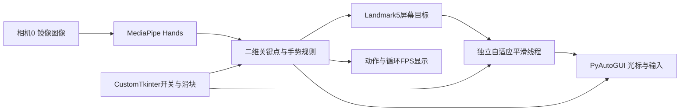

# Virtual Mouse and Gesture Control

基于 MediaPipe Hands、OpenCV、PyAutoGUI 与 CustomTkinter 的相机手势鼠标原型。

**简体中文** · [English](README.md) · [日本語](README_JA.md)

**深入阅读：** [技术说明](docs/technical-notes.zh-CN.md) · [部署与操作](docs/setup.zh-CN.md)

项目将现成手部关键点检测接入操作系统鼠标控制，探索关节定位、掌尺度归一化、平滑追踪与手势状态的组合。视觉检测、光标逼近和界面更新分开执行；没有项目自训练的手部模型，也没有可复核的工业级或固定时延成绩。

## 系统结构



后台检测循环请求640×480；另一个守护线程等待`1/180 s`后继续平滑，GUI每100 ms更新状态。它们是调度配置，不代表已测得180 Hz输入或相机帧率。

## 操作与工程设计

| 操作 | 实际判定 |
| :--- | :--- |
| 移动 | 非滚动时，食指伸出或左键仍按住；始终跟踪食指根部Landmark5。 |
| 左键／拖动 | 上述移动分支中，拇指与食指尖距离／掌尺度小于0.35时mouseDown，松开mouseUp。 |
| 右击 | 未进入移动分支、非滚动且拇指中指比值小于0.35；有0.5 s间隔。 |
| 滚动 | 食指、中指、无名指伸出，小指收起；以中指根部相对起始Y偏移作为摇杆。 |
| 设置／显示 | 控制／预览开关、平滑度1–15、X/Y灵敏度1–3，手别、动作、循环FPS。 |

掌尺度取0到9号点的二维距离；目标相机死区0.6像素、屏幕目标死区1.5像素，另有按剩余距离调节的平滑。[公式与状态优先级](docs/technical-notes.zh-CN.md)。

## 展示与验证范围


历史追踪与捏合截图见[技术说明](docs/technical-notes.zh-CN.md#evidence)。截图中180 Hz卡片是固定文字，不能作为实测；没有保留可复现的CPU、内存、延迟或多分辨率基准记录。

本轮四份Python文件静态解析通过，未启动相机、GUI或派发真实鼠标事件。

## 快速开始

```powershell
python -m pip install -r requirements.txt
python main.py
```

使用支持桌面GUI、相机及系统输入权限的Python环境；MediaPipe必须提供`mp.solutions.hands`。默认启动即启用控制，打开摄像头0；先查看[运行与已知退出问题](docs/setup.zh-CN.md)，再进行实际操作。没有网络控制端或训练权重准备步骤。

## 限制与后续

只使用x/y，不能宣称完整3D姿态、任意视角或深度不变性；张掌仍可能移动。当前修复统一了暂停、失手、相机错误和退出的输入释放；右键按每次捏合边沿触发，退化掌尺度不参与识别。共享输入状态由锁保护，平滑线程可以停止并等待退出。

10项无桌面输入的回归测试通过；没有摄像头、GUI或真实OS输入验收。后续需在目标桌面验证操作成功率、相机驱动退出和实际延迟。

## 归属与许可

仓库由 **刘超然 / Chaoran Liu** 维护。MediaPipe提供检测和关键点模型，项目代码负责规则、控制、平滑和GUI整合；MCP在此指掌指关节，不是Model Context Protocol。

代码见[MIT](LICENSE)，第三方依赖分别遵循其授权。[技术说明](docs/technical-notes.zh-CN.md) · [部署指南](docs/setup.zh-CN.md)
